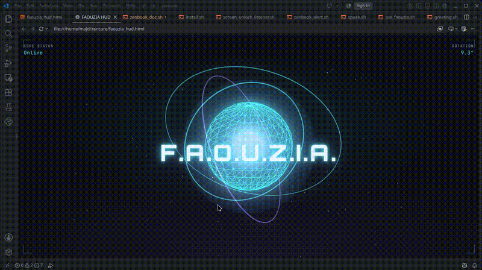
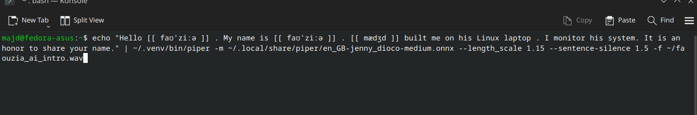
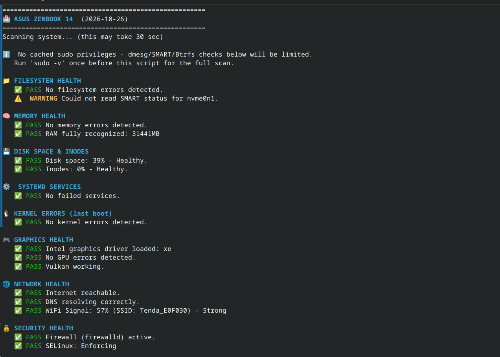
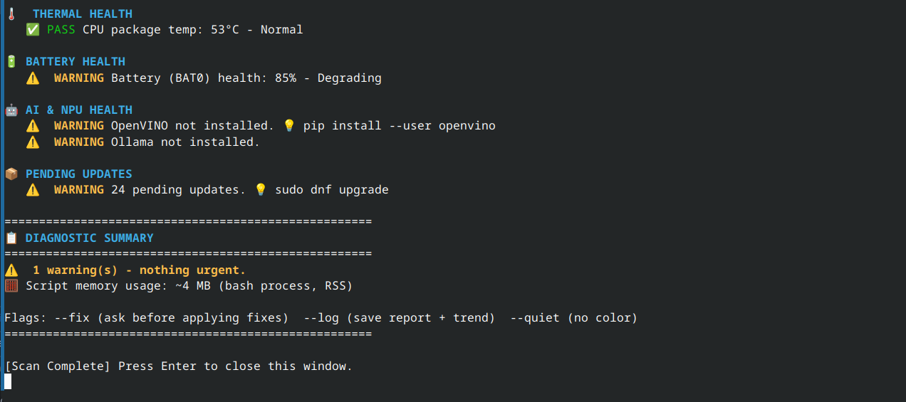
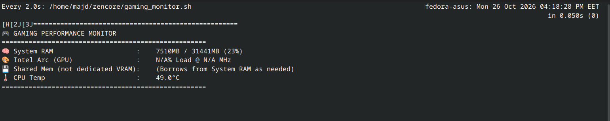
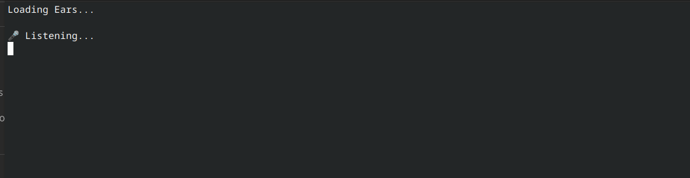

# F.A.O.U.Z.I.A. (Fully Automated Operating Utility and Zenith Intelligence Assistant)
A personal, offline AI project named after Faouzia. 

## 📸 Screenshots

## 🎙️ What is this?
F.A.O.U.Z.I.A. is a fully offline, voice-activated system assistant built on Linux (Fedora KDE). Inspired by AI systems like J.A,R.V.I.S./F.R.I.D.A.Y. from the Marvel universe, I wanted to build a local AI that monitors my laptop's health, manages security, and speaks with a natural voice.

I named her F.A.O.U.Z.I.A. because I am a fan of Faouzia.

## ✨ Key Features
*   **100% Offline & Private:** Uses Piper TTS for voice generation and Faster-Whisper for speech recognition. No data ever leaves the laptop.
*   **System Doctor:** A custom Bash script that monitors CPU, RAM, thermals, and network security.
*   **Voice Alerts:** She speaks out loud if the CPU gets too hot, if a system service fails, or if an intruder tries to breach the firewall.
*   **Wake Word:** Listens for "Hey Jarvis" (or "Hey Faouzia" in future updates) to execute voice commands like "Open Firefox" or "Open Spotify."
*   **Native Linux Integration:** Runs silently in the background using systemd timers and integrates with the KDE Plasma desktop.

## 🛠️ The Tech Stack
*   **OS:** Fedora KDE Plasma
*   **Languages:** Python 3.12, Bash
*   **Voice:** Piper TTS
*   **AI/STT:** Faster-Whisper, OpenWakeWord
*   **Security:** Systemd, Fail2Ban, Firewalld

## 📂 File Architecture (`~/zencore/`)
- `zenbook_doc.sh`: The core diagnostic engine (50-point scan).
- `zenbook_alert.sh`: Background daemon (runs every 30m) for silent notifications and voice alerts.
- `temp_guard.sh`: Thermal protection (runs every 1m). Pops up a Konsole HUD if CPU > 85°C.
- `network_guard.sh`: Intruder alert. Monitors Fail2Ban logs and speaks if an IP is banned.
- `greeting.sh`: The login/unlock script. Gives a smart summary and opens the scan.
- `faouzia_ears-onBattery.py`: Push-to-talk voice assistant (triggered by keyboard shortcut) while on battery.
- `faouzia_ears-pluggedIn.py`: Always-on Alexa-style wake word listener, when plugged in .
- `screen_unlock_listener.sh`: Listens to D-Bus for KDE screen unlocks to trigger `greeting.sh`.
- `ask_faouzia.sh`: Manual terminal command to trigger a system scan.

- ## 🔮 Future Ideas (V2.0)
- [ ] Integrate Ollama for conversational intelligence.
- [ ] Create a custom wake word ("Faouzia. you up?") using OpenWakeWord training.
- [ ] Make her available on cross-devices
